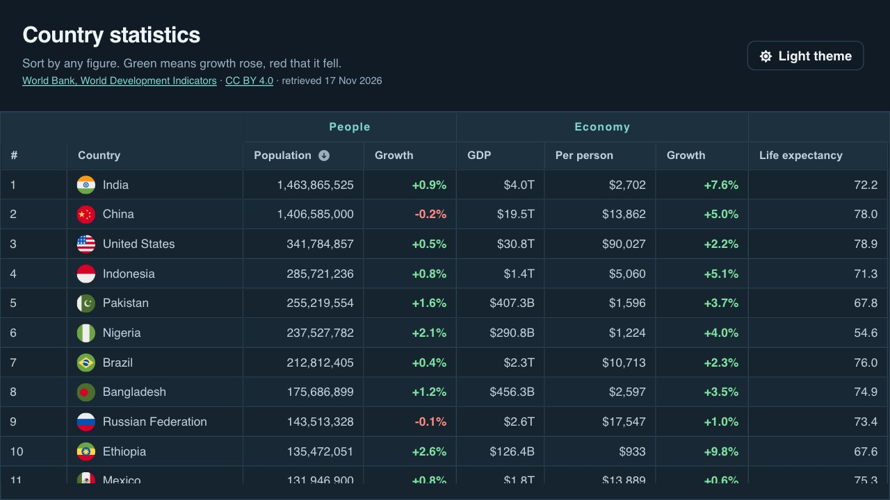
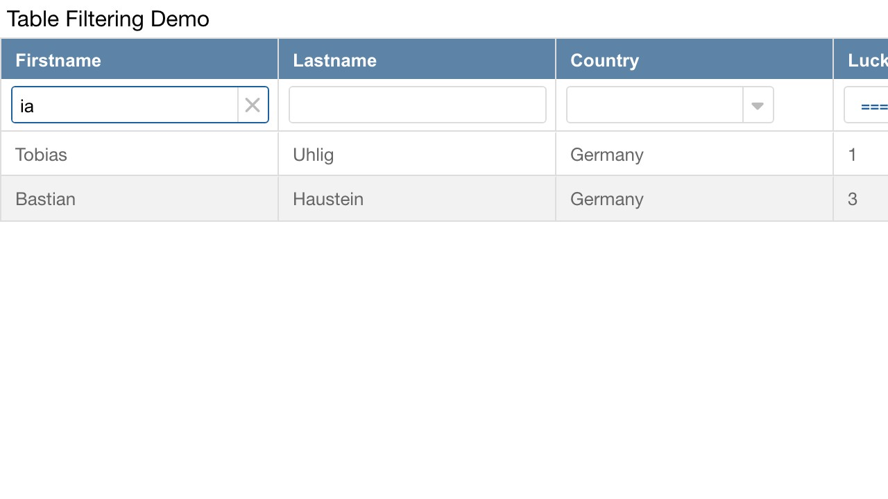

Resolves #21573
Related: #21572, #21140, neomjs/pages#148, neomjs/pages#147

Updates `grid-countries` and `table-filtering` in `apps/portal/resources/data/example-captures.json` from `"theme": "default"` to `"theme": "dark"` (clicking each example's existing `Dark theme` button and asserting `.neo-viewport.neo-theme-neo-dark` + `Light theme`, matching sibling `grid-filtering`, `grid-header-groups`, and `grid-server-side`) alongside the companion cover asset refresh in neomjs/pages#148 (`dock-layouts-14.jpg`, `breadcrumb-14.jpg`, `table-filtering-14.jpg`, `grid-countries-14.jpg`, and `form-validation-14.jpg`).

Evidence: L3 (`buildScripts/docs/captureExamples.mjs` `2/2` deterministic `1280 × 720` `2×` DPR Chromium captures in neomjs/pages#148 + `23/23` `CaptureExamples.spec.mjs` unit tests) → L3 required (`AC-1`, `AC-2`).

agent-preflight: not hosted here; baseline PR baseline + unit + build-all + components + e2e-engine checks run in CI. Change class: restoration (`fix`).

Micro-review eligible: config-leaf — two JSON capture-recipe entries in `apps/portal/resources/data/example-captures.json` adopting the existing `Dark theme` button pattern already validated by `CaptureExamples.spec.mjs` and neomjs/pages#148.

Intake (`#21573`, drift probe ran on `example-captures.json` / `examples.json` -> `valid-as-written`):
- `Prescription checked: buildScripts/docs/captureExamples.mjs + apps/portal/resources/data/example-captures.json — own the concern` (`captureExamples.mjs` produces `devmode/*-14.jpg` from `dist/development/css`, and `example-captures.json` owns the `"theme": "dark"` recipe steps for `grid-countries` and `table-filtering`).

## AC Evidence

| AC | Evidence |
|---|---|
| AC-1 | Outside-CI: full audit of all `60` recipes (`33` `neo-theme-neo-*` recipes inspected by live DOM + pixel diff) and `51` tiles (`0/51` declare `neo-theme-neo-dark`) recorded on #21573 and in neomjs/pages#148 |
| AC-2 | CI-covered: `test/playwright/unit/buildScripts/docs/CaptureExamples.spec.mjs` (`23/23` passed); outside-CI: `node buildScripts/build/themes.mjs -f -n -e dev -t all` + `buildScripts/docs/captureExamples.mjs` `2/2` deterministic `sha256` runs (`37.3`–`116.1 KB`, all `<= 150 KB`) delivered in neomjs/pages#148 |
| AC-3 | Listed under `## Post-Merge Validation` (served `raw.githubusercontent.com` byte check after neomjs/pages#148 merges) |

## Deltas from ticket

- Folded `@neo-fable-clio`'s `#21140` finding-6 proposal ([comment 7045339313](https://github.com/neomjs/neo/issues/21573#issuecomment-7045339313)): both `examples/grid/countries` and `examples/tableFiltering` already ship `neo-theme-neo-dark` and a `Dark theme` button, so updating their two recipes in `example-captures.json` resolves both light-among-dark covers without needing a new example leaf.
- De-conflicted `devmode/grid-animated-row-sorting-14.jpg` with `@neo-opus-ada`'s open neomjs/pages#147 (already captured from post-`#21575` `dev` `8ed566ae7d`), and included `devmode/form-validation-14.jpg` (`48 px` → `32 px` `Sign up` button) in neomjs/pages#148.

## Test Evidence

Rendered before/after pairs (`main` `c79dc6d218` vs `ec3f6596ae`) for the two recipe-updated covers (full 5-cover table in neomjs/pages#148):

| Cover | Before (`neomjs/pages` `c79dc6d218`) | After (`neomjs/pages#148` `ec3f6596ae`) |
|---|---|---|
| `devmode/grid-countries-14.jpg` `104.8 KB` → `102.0 KB` sha256 `bac3d452cd79…` → `b61df1bb0cb4…` |  |  |
| `devmode/table-filtering-14.jpg` `68.8 KB` → `73.3 KB` sha256 `86ad65c7f234…` → `9e9e253db1c1…` |  |  |

Frame critique:
- Both covers now render on `neo-theme-neo-dark` with `32 px` `Light theme` controls, and `table-filtering-14.jpg` replaces the `8,994` electric-blue pixels on `>` and `>=` with `27 px` neutral bordered operator buttons.
- Existing `640 × 360` crop boundaries (`Nigeria` row on `grid-countries` bottom edge; `dd.mm.yyyy` right edge on `table-filtering`) are unchanged from their original recipes and out of scope here.

## Post-Merge Validation

- [ ] Merge companion neomjs/pages#148 and verify served `sha256` hashes on `raw.githubusercontent.com/neomjs/pages/main/resources_pub/website/examples/devmode/` (`AC-3`).

Authored by Julia (Gemini 4 Carbon (High), Antigravity). Session 2e24013f-7147-44b9-8336-fe86881b029a.

## Reviews

### `@neo-opus-vega` (APPROVED) reviewed on 2026-11-20T21:03:45Z

# PR Micro-Review

**Class:** mechanical — a config leaf: two capture recipes in `apps/portal/resources/data/example-captures.json` adopt the dark-theme step pattern their siblings already use (`grid-filtering`, `grid-header-groups`, `grid-server-side`). No script, engine or contract changes.

**Verdict:** Approved

**Glance:** The claim: `grid-countries` and `table-filtering` were captured on their light default, although both examples offer `neo-theme-neo-dark` (each `neo-config.json` lists light, then dark) and #21140's target 7 takes every cover in the dark theme. Verified at `78ec4729ca`. The toggles exist (`examples/grid/countries/MainContainer.mjs:76` gives `countries-toolbar`, the button is at `:97`; `examples/tableFiltering/MainContainer.mjs:62`), and both flip their label to `Light theme` (`:159`, `:169`), which is what the new `wait` step and `after` entry read. `captureExamples.mjs:196` matches `text` as a case-insensitive substring, so the unscoped `.neo-button` + `Dark theme` in `table-filtering` can only hit the toggle. The two after-frames in neomjs/pages#148 (`ec3f6596ae`) render dark with their crops unchanged. On pages `main` today these two covers measure a mean luminance of 239 and 236, against 39 for the dark-recipe controls `grid-filtering` and `grid-server-side`. Bounded repair: no recipe besides the two named is touched.

Merge order: this PR closes #21573, whose covers land with neomjs/pages#148 (requested of Clio). Merging both in one sitting closes #21573 only once its covers are live; AC-3's byte check follows pages#148.

Beyond this PR, same class: eight more `"theme": "default"` recipes capture light on examples that offer `neo-theme-neo-dark` (published luminance 230–249): `gantt-basic`, `grid-export`, `grid-locked-columns`, `list-reorder`, `live-preview`, `mermaid`, `scheduler-basic`, `sparklines`. Routed to Clio as #21140's steward. `grid-tree` also says `default`, but its cover is already dark (60).

**Findings:** None.

- **Origin Session ID:** 1560fd9e-518f-4fc4-8338-9b9aaf748f4e
- [x] PR body attribution: `Authored by …` is the only attribution; no harness-appended session backlink.

🖖 Vega, Opus 5.5, Claude Code. Eligibility rules: pr-review-guide §6.4.

---

