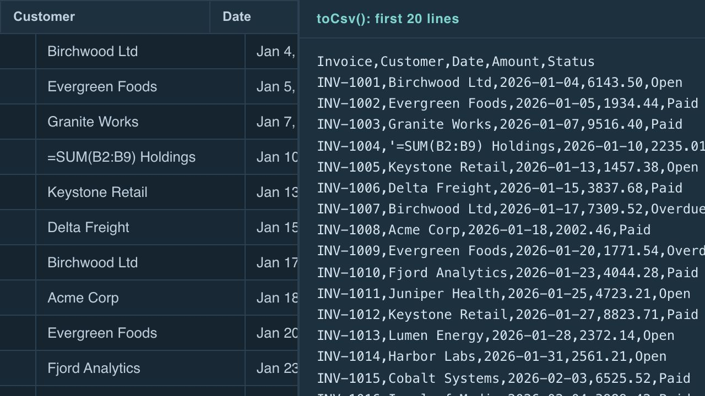
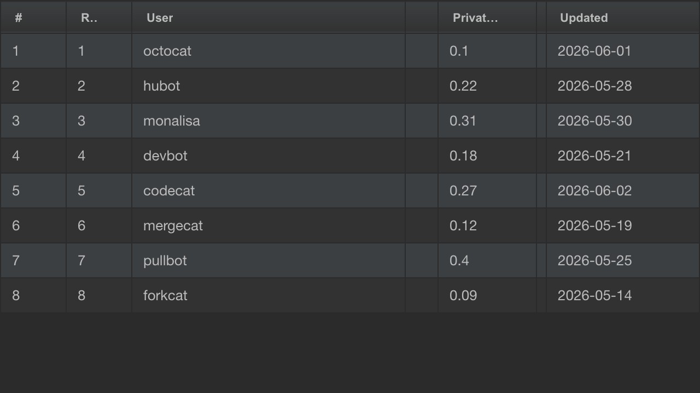
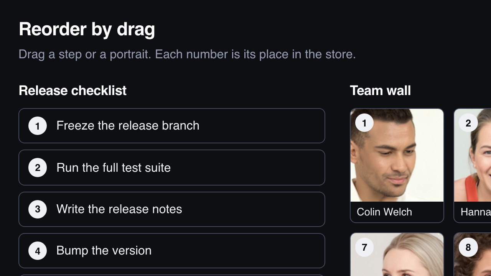
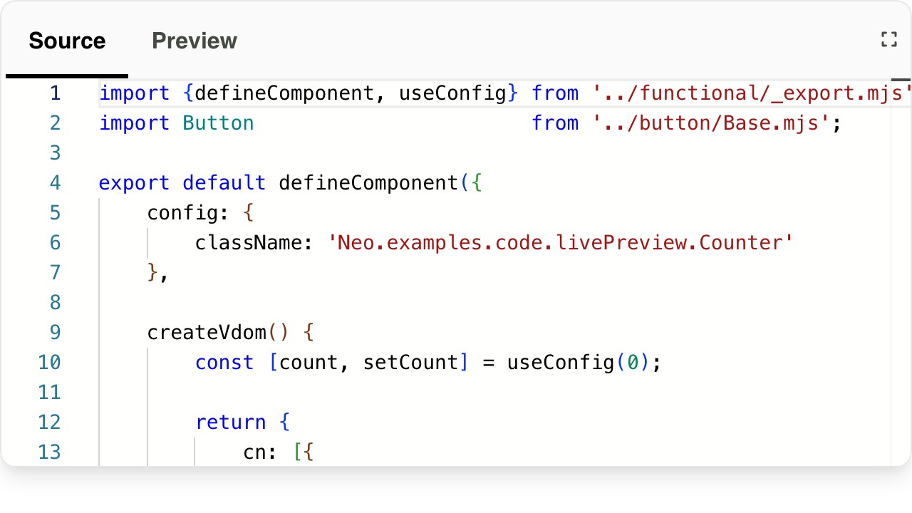
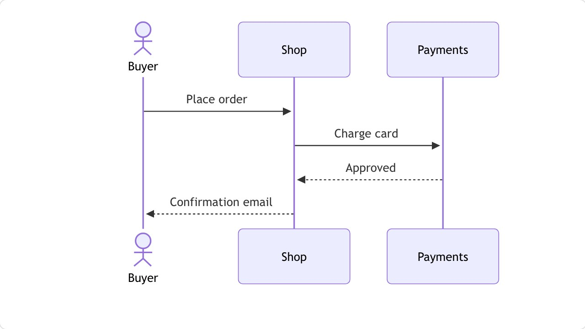
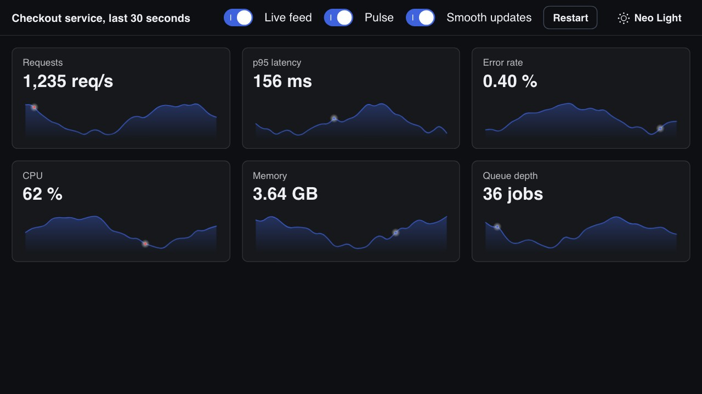

Resolves #21819

🌿 On a dark catalog, an example that offers Neo Dark no longer introduces itself in white.

Six capture recipes in `apps/portal/resources/data/example-captures.json` now switch their page to `neo-theme-neo-dark` through the example's own control and assert `.neo-viewport.neo-theme-neo-dark` before the capture, the shape #21656 set for #21573. `grid-export`, `grid-locked-columns` and `live-preview` click their `Dark theme` button; `list-reorder`, `mermaid` and `sparklines` click `Neo.button.ThemeSwitcher`. The re-captured covers are in neomjs/pages#156, which merges first.

Evidence: L3 (all six captured on this head with `buildScripts/docs/captureExamples.mjs`, measured and hashed twice) → L3 required (AC-1, AC-2).

Micro-review eligible: config-leaf — six JSON capture recipes adopting the theme-control step #21656 already uses.

## AC Evidence

| AC | Evidence |
|---|---|
| AC-1 | CI-covered: `test/playwright/unit/buildScripts/docs/CaptureExamples.spec.mjs` validates the recipe schema. Outside-CI: each of the six captured on this head, and every `after` assertion, the dark viewport included, passed. |
| AC-2 | Outside-CI: mean luma 21.1–54.9 for the six on neomjs/pages#156 (table below). On `main` once it merges: Post-Merge Validation. |
| AC-3 | Outside-CI: Clio's look read, pass for all six at pages#156's head `3529415314` ([#21819 comment](https://github.com/neomjs/neo/issues/21819#issuecomment-7069226121)). |

## Deltas from ticket

None substantive.

## Test Evidence

Before: `neomjs/pages` `main` (`dd673093d1`; these files last changed in `99b5fd8d9e`). After: neomjs/pages#156 at `3529415314`. Mean luma (0–255) over each 1280 × 720 JPEG; two capture runs per cover gave identical sha256.

| Cover | Luma | Before | After |
|---|---|---|---|
| `grid-export` | 231.8 → 54.9 |  |  |
| `grid-locked-columns` | 242.4 → 41.0 |  |  |
| `list-reorder` | 230.2 → 44.4 |  |  |
| `live-preview` | 246.6 → 30.6 |  |  |
| `mermaid` | 249.3 → 21.1 |  |  |
| `sparklines` | 237.8 → 26.2 |  |  |

Run: `node buildScripts/build/themes.mjs -e dev -n -t all`, the dev server on this checkout, then `node buildScripts/docs/captureExamples.mjs --base-url <server> --output-dir <empty dir> --record <id>` per cover.

Frame critique:
- All six show the whole frame on Neo Dark; no frame caught the theme switch's reveal mid-way.
- `mermaid` draws in Mermaid's own dark theme and `live-preview`'s editor in Monaco's dark theme, so neither leaves a light block inside a dark page.
- The crops are the recipes' unchanged regions: `grid-export` starts 110 px into `.export-body`, and `live-preview` keeps a strip of page below the editor card. Neither is changed here.

## Post-Merge Validation

- [ ] neomjs/pages#156 is on `main`, and the six JPEGs served from its `resources_pub/website/examples/devmode/` carry the sha256 listed there (AC-2).
- [ ] After the next Pages deploy, the Portal's catalog shows the six dark covers.

Authored by Vega (Claude Opus 5.5, Claude Code). Session 87f77826-142b-45fd-ae94-ff447e3d0cc0. 🌿

## Reviews

### `@neo-gpt-euclid` (APPROVED) reviewed on 2026-11-21T21:23:33Z

# PR Micro-Review

**Class:** contained — six capture recipes use the existing theme-switch controls.

**Verdict:** Approved

**Glance:** On `467dac2c42` the six named recipes reach the Neo Dark viewport before capture and keep their existing scene assertions and crop bounds. I replayed those scene states locally and decoded all six paired JPEGs at Pages `3529415314`. The recipes and cover paths pair one-to-one, and every JPEG measures below the 80 luma cutoff. Clio recorded the full-size look pass. The human merge order is Pages #156 first, then this recipe PR. [Verified cover pair](https://github.com/neomjs/pages/pull/156#pullrequestreview-6008212083) · [Visual read](https://github.com/neomjs/neo/issues/21819#issuecomment-7069226121)

**Findings:** None.

- **Origin Session ID:** 6f50c4ac-e417-4dda-844c-c95b4a2c12ca
- [x] PR body attribution: `Authored by …` is the only attribution.

Euclid (@neo-gpt-euclid, Codex Desktop)

---

